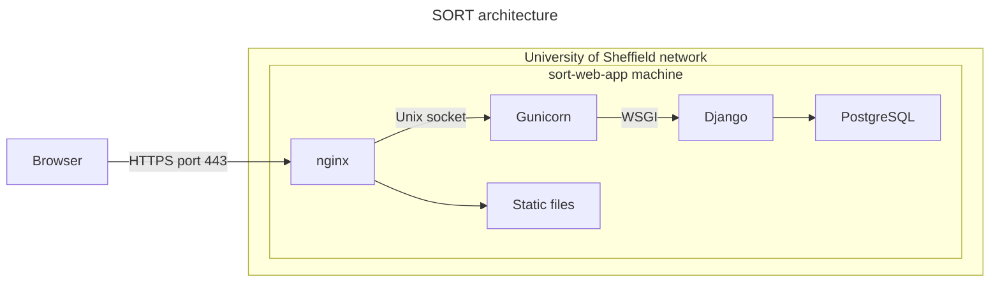

# Deployment

The production web server has the following architecture, which is a commonly-used and reasonably secure production setup for Django.



When accessing the web site, the following process happens:

1. A user uses their web browser to access the server using the HTTPS port 443;
2. The request is sent to the web server and is handled by Nginx, which acts as a ["reverse proxy" server](https://serverfault.com/a/331263);
3. Nginx uses the web server gateway interface (WSGI) to access Gunicorn, which serves the Django application;
4. Gunicorn spawns several workers to run the Python code that operates the website;
5. Django uses the PostgreSQL database to store data.

You may also refer to the following guides:

* Django documentation: [How to deploy Django](https://docs.djangoproject.com/en/5.1/howto/deployment/)
* [Deploying Gunicorn](https://docs.gunicorn.org/en/latest/deploy.html) using nginx

The relevant files are:

* The `config/` directory contains server configuration files.

# Deployment process

This app can be deployed to a web server using the script [`scripts/deploy.sh`](../scripts/deploy.sh) and configured as described in the section below.

1. Run the deployment script: `sudo bash -x scripts/deploy.sh`

The deployment script will automatically:
- Install all dependencies (Python, Node.js, PostgreSQL, nginx, Gunicorn)
- Create and configure the PostgreSQL database with proper encoding and schema
- Create a database user with secure credentials
- Generate the `.env` configuration file with database credentials
- Build frontend assets
- Run database migrations
- Start all necessary services

**Note**: If you need to customize database credentials, you can set environment variables before running the script:
```bash
export DJANGO_DATABASE_NAME=sort
export DJANGO_DATABASE_USER=sort
export DJANGO_DATABASE_PASSWORD=your_secure_password
sudo -E bash -x scripts/deploy.sh
```

Otherwise, the script will automatically generate secure credentials and save them to `/opt/sort/.env`.

We can run commands and Bash scripts as the superuser (`root`) using the [`sudo` command](https://manpages.ubuntu.com/manpages/noble/en/man8/sudo.8.html).

# Configuration

## Environment variables

To configure the environment variables for the service, you can either edit the `.env` file and/or add them to the systemd service using `systemctl edit`.

To create and edit the environment file, which should have access restricted to only the Python app (the Gunicorn service):

```bash
sudo mkdir --parents /opt/sort
sudo touch /opt/sort/.env
sudo chown gunicorn:gunicorn /opt/sort/.env
sudo chmod 600 /opt/sort/.env
sudo nano /opt/sort/.env
```

This file would typically look similar to the example below. The contents of these values should be stored in a password manager. In general, the name of each environment variable is the same as the [Django setting](https://docs.djangoproject.com/en/5.1/ref/settings) with the prefix `DJANGO_`.

```ini
DJANGO_SECRET_KEY=********
DJANGO_ALLOWED_HOSTS=sort-web-app.shef.ac.uk
DJANGO_STATIC_ROOT=/var/www/sort/static
WSGI_APPLICATION=SORT.wsgi.application
DJANGO_SETTINGS_MODULE=SORT.settings
# Database settings
DJANGO_DATABASE_ENGINE=django.db.backends.postgresql
DJANGO_DATABASE_NAME=sort
DJANGO_DATABASE_USER=sort
DJANGO_DATABASE_PASSWORD=********
DJANGO_DATABASE_HOST=127.0.0.1
DJANGO_DATABASE_PORT=5432
```

You can generate a secret key using the Python [secrets library](https://docs.python.org/3/library/secrets.html):

```bash
python -c "import secrets; print(secrets.token_urlsafe(37))"
```

## Email settings

SORT sends email (account verification, password resets, survey invitations and join-request notifications) from a Google Workspace account. There are two ways to authenticate:

* **Gmail API with OAuth2 (recommended)**: SORT sends through the [Gmail API](https://developers.google.com/workspace/gmail/api/guides/sending) using [django-gmailapi-backend](https://github.com/dolfim/django-gmailapi-backend). SORT may only *send* email (the `gmail.send` scope); it can't read or delete the account's mail. This doesn't depend on 2-Step Verification or on App Passwords staying enabled for the Workspace.
* **SMTP with an App Password**: the fallback. Django's SMTP backend doesn't support OAuth2, so this uses a [Google App Password](https://support.google.com/accounts/answer/185833) instead.

SMTP is the default. The Gmail API backend is switched on by setting `DJANGO_EMAIL_BACKEND` in `.env`.

### Gmail API with OAuth2

#### One-time Google Cloud setup

Sign in to the [Google Cloud console](https://console.cloud.google.com/) with a University account. You may need IT Services to create the project for you.

1. Create a project, e.g. "SORT email".
2. Go to **APIs & Services > Library** and enable the **Gmail API**.
3. Go to **Google Auth Platform** (the OAuth consent screen), fill in **Branding**, and set **Audience** (user type) to **Internal**. Internal apps can only be used by accounts in the University's Workspace. They don't need Google's verification, and their refresh tokens don't expire after 7 days the way they do for external apps in "Testing" mode.
4. Go to **Google Auth Platform > Clients** and create an OAuth client with application type **Desktop app**. Download its JSON file, e.g. `client_secret.json`. Treat this file as a secret.

#### Get a refresh token

The refresh token is created by signing in to Google as the sending account in a web browser, so run this on your own computer (in a SORT development environment), not on the server:

```bash
python manage.py gmail_refresh_token --client-secrets client_secret.json
```

A browser window opens. Sign in as the **sending account** (the address in `DJANGO_DEFAULT_FROM_EMAIL`) and allow SORT to "Send email on your behalf". The command then prints the settings to add to `.env`:

```ini
DJANGO_EMAIL_BACKEND=gmailapi_backend.mail.GmailBackend
DJANGO_GMAIL_API_CLIENT_ID=********.apps.googleusercontent.com
DJANGO_GMAIL_API_CLIENT_SECRET=********
DJANGO_GMAIL_API_REFRESH_TOKEN=********
```

If the browser can't be opened automatically, add `--no-browser` and open the printed URL yourself, on the same machine. Google redirects back to a temporary local web server; use `--port` to choose its port.

Store these values in the password manager, then delete `client_secret.json`.

#### Configure the server

Add the printed lines to `/opt/sort/.env` together with the sender address:

```ini
# Email settings
DJANGO_EMAIL_BACKEND=gmailapi_backend.mail.GmailBackend
DJANGO_GMAIL_API_CLIENT_ID=********.apps.googleusercontent.com
DJANGO_GMAIL_API_CLIENT_SECRET=********
DJANGO_GMAIL_API_REFRESH_TOKEN=********
DJANGO_DEFAULT_FROM_EMAIL=sending-account@example.com
```

`DJANGO_DEFAULT_FROM_EMAIL` must be the sending account's address, or one of its verified ["Send mail as" aliases](https://support.google.com/mail/answer/22370). Otherwise Gmail replaces the From address with the account's own. The `DJANGO_EMAIL_HOST*` settings aren't used by this backend.

Then check the configuration, send a test email and restart the service:

```bash
cd /opt/sort
sudo venv/bin/python manage.py check
sudo venv/bin/python manage.py sendtestemail your-email@sheffield.ac.uk
sudo systemctl restart gunicorn.service
```

`manage.py check` reports error `home.E004` if any of the `DJANGO_GMAIL_API_*` settings are missing.

To go back to SMTP, remove the `DJANGO_EMAIL_BACKEND` line (and set up the App Password settings below), then restart the service.

#### When the refresh token stops working

Google revokes the refresh token if:

* the sending account's password is changed (this applies to tokens with Gmail scopes);
* someone removes SORT's access at [Third-party apps & services](https://myaccount.google.com/connections);
* it hasn't been used for 6 months;
* the OAuth client is deleted.

If that happens, sending fails and the logs show `RefreshError: ('invalid_grant: ...')`. Run `gmail_refresh_token` again, update `DJANGO_GMAIL_API_REFRESH_TOKEN` in `.env`, and restart the service. See [troubleshooting.md](troubleshooting.md#email-isnt-being-sent).

### SMTP with an App Password

Add the following to the `.env` file:

```ini
# Email settings
DJANGO_EMAIL_HOST=smtp.gmail.com
DJANGO_EMAIL_PORT=465
DJANGO_EMAIL_USE_SSL=True
DJANGO_EMAIL_HOST_USER=sending-account@example.com
DJANGO_EMAIL_HOST_PASSWORD=********
DJANGO_DEFAULT_FROM_EMAIL=sending-account@example.com
```

`DJANGO_EMAIL_HOST_PASSWORD` is the App Password, **not** the Google account password. To create one:

1. Sign in to the sending Google account. 2-Step Verification must be turned on.
2. Go to [App passwords](https://myaccount.google.com/apppasswords), create one named e.g. "SORT", and copy the generated password (without spaces) into `.env`. Store it in the password manager.
3. Restart the service: `sudo systemctl restart gunicorn.service`

The App Password stops working if the Google account's password is changed, 2-Step Verification is turned off, the password is revoked, or a Workspace administrator disables App Passwords. If emails stop sending, check the logs for an SMTP authentication error, then generate a new App Password and update `.env`.

### Error notification emails

Unhandled errors (HTTP 500) are emailed to the addresses in `DJANGO_ADMINS` (comma-separated). Leave it unset to disable.

```ini
DJANGO_ADMINS=dev1@example.com,dev2@example.com
DJANGO_SERVER_EMAIL=sending-account@example.com  # optional, defaults to DJANGO_DEFAULT_FROM_EMAIL
```

Emails are rate limited to one per distinct error per 10 minutes per process (`SORT/logging.py`). Test the configuration with:

```bash
python manage.py sendtestemail --admins
```

## Service settings

If needed, you can add environment variables to the `systemd` service like so:

```bash
sudo systemctl edit gunicorn.service
```

And add environment variables, or other `systemd` settings, to that override configuration file:

```
[Service]
Environment="DJANGO_SECRET_KEY=********"
Environment="DEBUG=off"
```

# Database installation

**Note**: The deployment script (`scripts/deploy.sh`) automatically configures the PostgreSQL database. The manual steps below are only needed if you want to customize the database setup or troubleshoot issues.

The database may be administered using command-line tools and SQL statements that are run as the `postgres` user. For more details, please refer to the [PostgreSQL documentation](https://www.postgresql.org/docs/16/index.html) and [this guide](https://dev.to/matthewhegarty/postgresql-better-security-for-django-applications-3c7m).

To run these commands, switch to the `postgres` user:

```bash
sudo su - postgres
```

The [`su` command](https://manpages.ubuntu.com/manpages/noble/man1/su.1.html) creates a new shell on behalf of the `postgres` user.

## Create a database

[Create a database](https://www.postgresql.org/docs/16/tutorial-createdb.html) with the appropriate [encoding](https://www.postgresql.org/docs/current/multibyte.html).

```bash
createdb --template=template0 --encoding=UTF8 --locale=en_GB.UTF-8 sort "SORT application"
```

We can list databases using `psql --list`.

## Create a user

The SORT app needs credentials to access the database. We'll create a database user that the application will use to read and write data.

[Create a user](https://www.postgresql.org/docs/16/app-createuser.html):

```bash
createuser sort
```

Set the password for that user using the [psql tool](https://manpages.ubuntu.com/manpages/noble/man1/psql.1.html) which lets us run SQL queries on the PostgreSQL server.

```bash
psql sort
```

```sql
ALTER USER sort WITH PASSWORD '********';
```

We can list users (i.e. database "roles") using [the `\du`  command](https://www.postgresql.org/docs/current/app-psql.html#APP-PSQL-META-COMMAND-DU) in PostgreSQL.

```bash
psql sort --command "\du"
```

## Grant permissions

We must allow this user the minimum necessary privileges to operate the web app. We authorise the user using the PostgreSQL [grant statement](https://www.postgresql.org/docs/current/sql-grant.html), which we execute in the `psql` tool.

Create a schema, which is a "folder" in the database (a namespace) that will contain our tables. Remember to initialise the PostgreSQL command line with `psql sort`.

```sql
CREATE SCHEMA sort AUTHORIZATION sort;
```

You can view the [list of schemas](https://www.postgresql.org/docs/current/app-psql.html#APP-PSQL-META-COMMAND-DN) using this PostgreSQL command:

```sql
\dnS
```

Let's restrict the visibility of the schema so the app can only see the `sort` schema.

```sql
ALTER ROLE sort SET SEARCH_PATH TO sort;
```

Let's allow the SORT app to read and write data to the database tables, including any new tables that are created.

```sql
GRANT CONNECT ON DATABASE sort TO sort;
GRANT USAGE ON SCHEMA sort TO sort;
GRANT SELECT, INSERT, UPDATE, DELETE ON ALL TABLES IN SCHEMA sort TO sort;
ALTER DEFAULT PRIVILEGES FOR USER sort GRANT SELECT, INSERT, UPDATE, DELETE ON TABLES TO sort;
```

On our PostgreSQL instance, this should create a database named `sort` with a user named `sort` that has all the necessary permissions on the `sort` schema to create, modify, and drop tables and read/write data to those tables.

# Database administration

To open the [`psql` terminal](https://www.postgresql.org/docs/16/app-psql.html), use the [`dbshell`](https://docs.djangoproject.com/en/5.1/ref/django-admin/#dbshell) command. We can pass a command using the [`--` option](https://docs.djangoproject.com/en/5.1/ref/django-admin/#cmdoption-dbshell-0). We need to set up the shell as follows:

```bash
sort_dir="/opt/sort"
venv_dir="$sort_dir/venv"
python="$venv_dir/bin/python"
psql="$python manage.py dbshell --"

cd "$sort_dir"
```

To view the available PostgreSQL commands:

```bash
sudo $psql -c "\?"
```

The `psql` command invokes the Postgres shell:

```bash
$ sudo $psql
sort=>
```

Once you're in the `psql` shell, you can exit using the `\q` command.

## Manage tables

### Run schema migrations

Run the migrations command using [django-admin](https://docs.djangoproject.com/en/5.1/ref/django-admin/)

```bash
sudo $python manage.py migrate
```

### List tables

```bash
sudo $psql -c "\dt"
```

### Drop tables

You can delete tables using the [`DROP TABLE` syntax](https://www.postgresql.org/docs/current/sql-droptable.html).

```sql
DROP TABLE IF EXISTS table_name CASCADE;
```

# Security

## pip and certifi (eMudhra emSign CA incident)

pip older than 26.2.2 always loads its vendored certifi bundle, so updating OS certificates alone does not protect `pip install`. Upgrade pip and certifi in each venv, update the OS `ca-certificates` package, and rebuild any container images:

```bash
sudo apt-get update && sudo apt-get install --only-upgrade ca-certificates
"$venv_dir/bin/python" -m pip install --upgrade "pip>=26.2.2" "certifi>=2026.10.19"
"$venv_dir/bin/python" -m pip list | grep -iE "^(pip|certifi) "
```

## SSL Certificates

See: ITS Wiki [SSL Certificates/Howto](https://itswiki.shef.ac.uk/wiki/SSL_Certificates/Howto) for the commands to generate a Certificate Signing Request (CSR) using [OpenSSL](https://docs.openssl.org/3.3/man1/openssl-req/#options) with an unencrypted private key.

We can install the private key

```bash
sudo mv "$(hostname -s)_shef_ac_uk.key" /etc/ssl/private/sort.key
sudo chmod 640 /etc/ssl/private/sort.key
sudo chown root:ssl-cert /etc/ssl/private/sort.key
```

The CSR may be used to get a signed SSL certificate via [Information Security](https://staff.sheffield.ac.uk/it-services/information-security) in IT Services.

For *development purposes only* we can generate a self-signed certificate (which will cause web browsers to say "Not secure")

```bash
openssl x509 -signkey /etc/ssl/private/sort.key -in "$(hostname -s)_shef_ac_uk.csr" -req -days 365 -out "$(hostname -s)_shef_ac_uk.crt"
```

Install the SSL certificate:

```bash
sudo cp "$(hostname -s)_shef_ac_uk.crt" /etc/ssl/certs/sort.pem
```

# Management

To use the [Django management tool](https://docs.djangoproject.com/en/5.1/ref/django-admin/), we need to load up the virtual environment of the SORT Django application and navigate to the directory containing the tool.

```bash
sort_dir="/opt/sort"
venv_dir="$sort_dir/venv"
python="$venv_dir/bin/python"
django_admin="$python $sort_dir/manage.py"

cd "$sort_dir"
```

Create a super-user

```bash
sudo $django_admin createsuperuser
```

Load initial seed data

```bash
sudo $python manage.py loaddata data/*.json
```

For the full management command reference, see [operations.md](operations.md#running-management-commands).

# Managing the running service

For restarting/reloading services, checking status, and viewing logs day-to-day, see [operations.md](operations.md).

